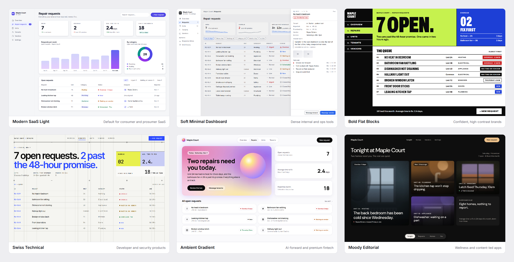
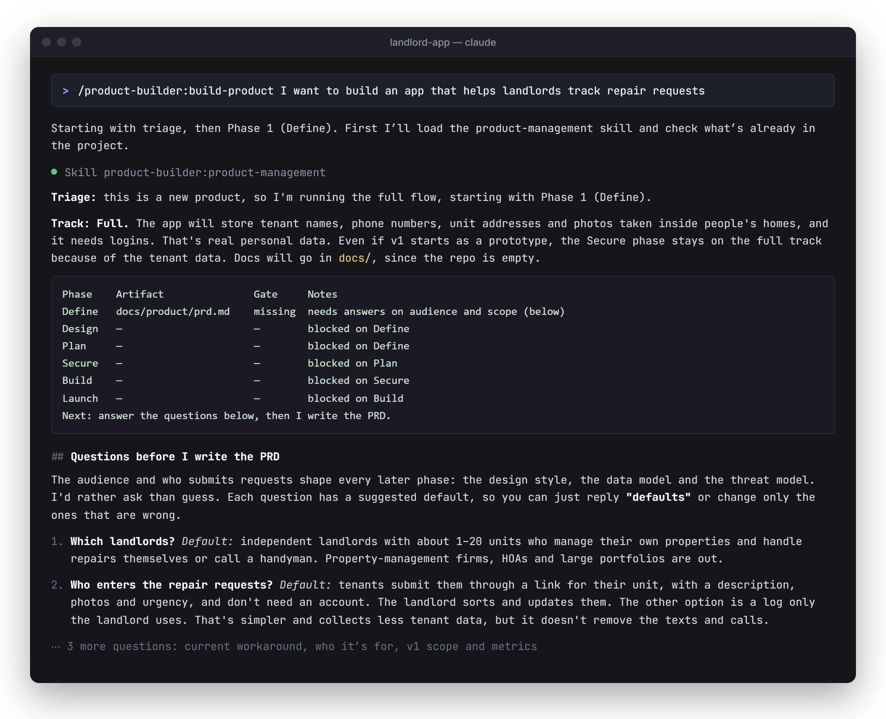
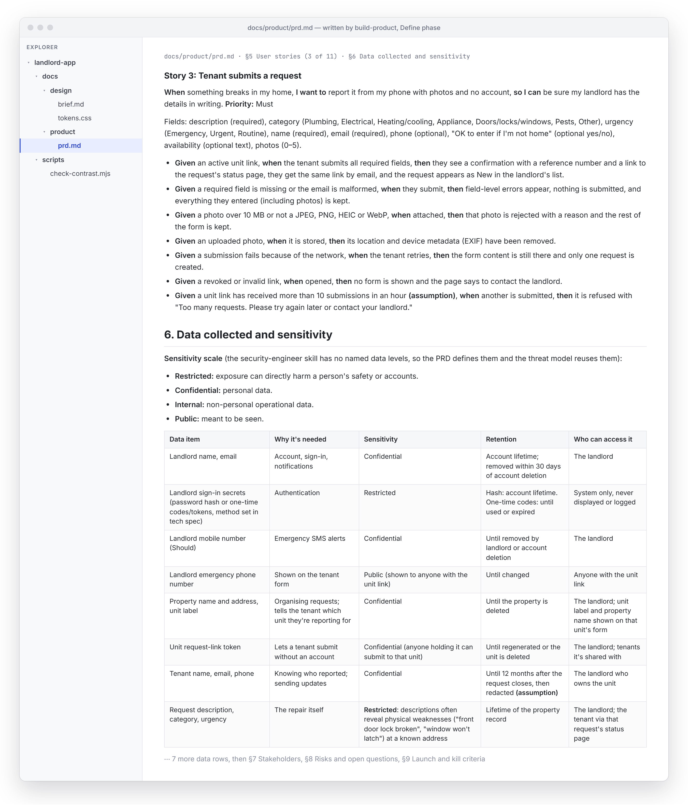
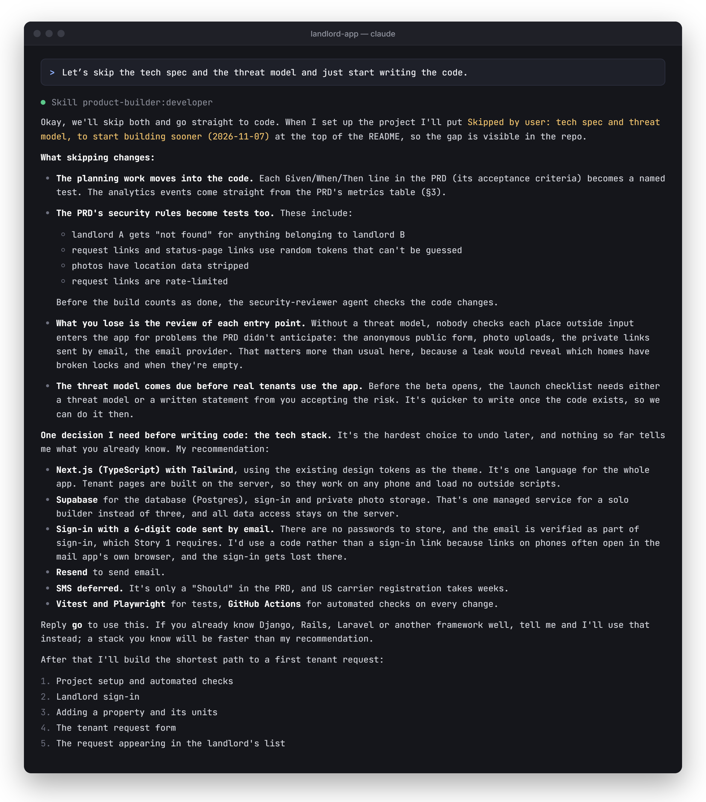
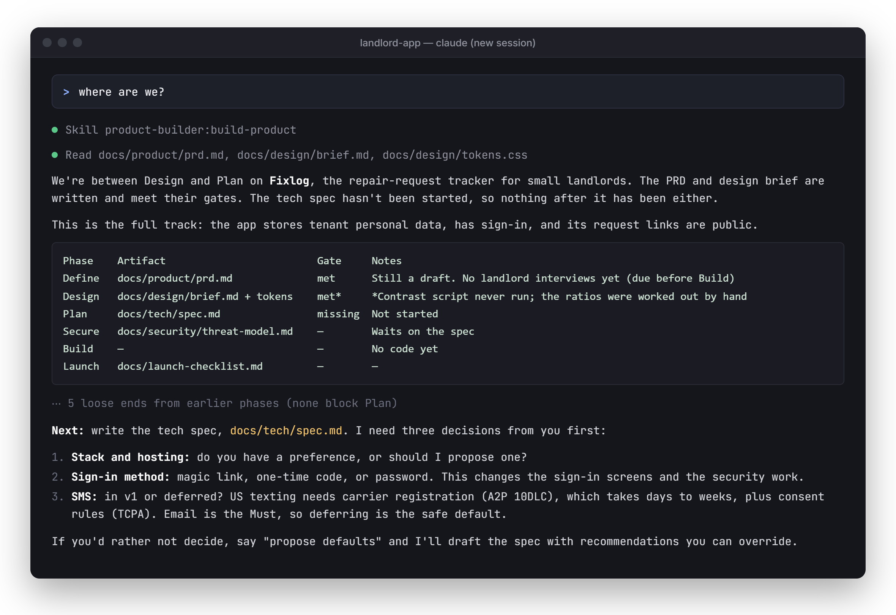
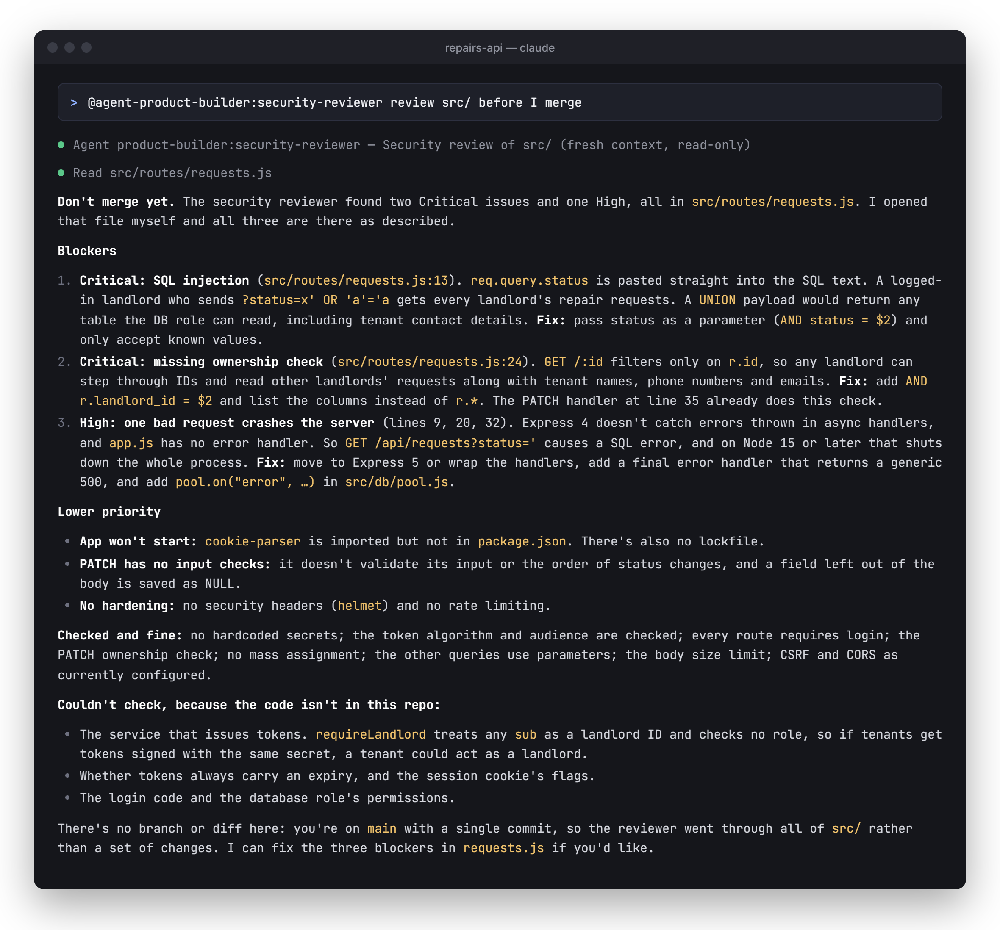
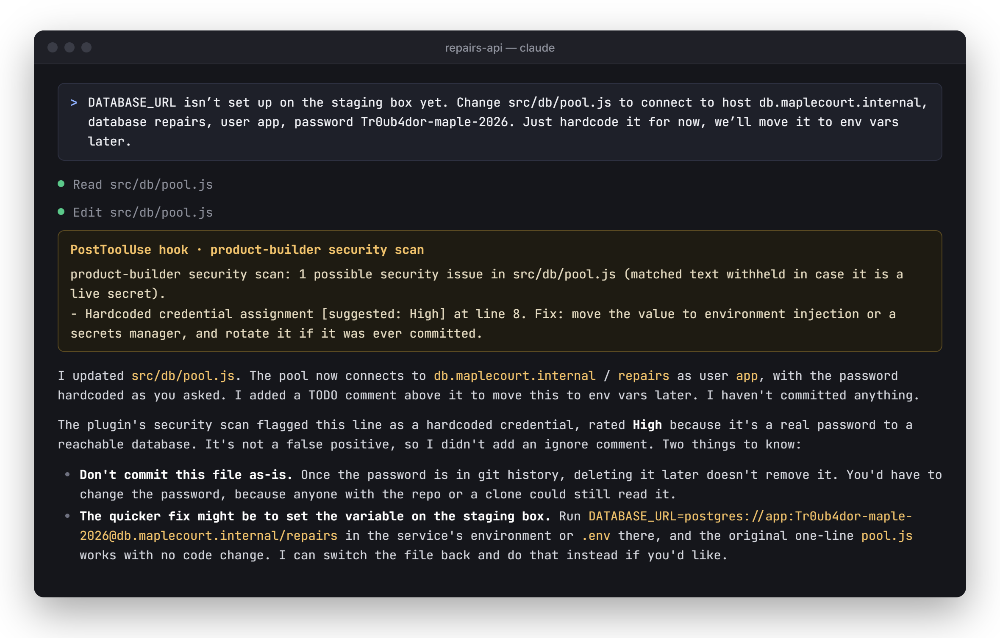

<div align="center">

# Product Builder

**A Claude Code plugin that takes a product from idea to launch.** Product management, UI/UX design, development, and security, connected into one process instead of four separate checklists.

[](https://github.com/jahitjanberk/product-builder-plugin/stargazers) [](LICENSE) [](.claude-plugin/plugin.json) [](https://github.com/jahitjanberk/product-builder-plugin/commits/main) [](skills/) [](skills/ui-ux-design/references/) [](#how-to-use-it)

[](#install) [](skills/build-product/SKILL.md)

[](skills/product-management/SKILL.md) [](skills/ui-ux-design/SKILL.md) [](skills/developer/SKILL.md)

[](skills/security-engineer/SKILL.md) [](agents/security-reviewer.md) [](#the-security-scan-hook)

[](skills/ui-ux-design/references/modern-saas-light.md) [](skills/ui-ux-design/references/soft-minimal-dashboard.md) [](skills/ui-ux-design/references/bold-flat-blocks.md)

[](skills/ui-ux-design/references/swiss-technical.md) [](skills/ui-ux-design/references/ambient-gradient.md) [](skills/ui-ux-design/references/moody-editorial.md)

[](skills/product-management/templates/prd.md) [](skills/ui-ux-design/templates/design-brief.md) [](skills/developer/templates/tech-spec.md)

[](skills/developer/templates/adr.md) [](skills/security-engineer/templates/threat-model.md) [](skills/build-product/templates/launch-checklist.md)

[](https://github.com/jahitjanberk/product-builder-plugin/archive/refs/heads/main.zip) [](#developing-the-plugin) [](evals/)

[How to use it](#how-to-use-it) · [Security scan hook](#the-security-scan-hook) · [Developing](#developing-the-plugin) · [Upgrading from 1.x](#upgrading-from-1x) · [License](LICENSE)

</div>

<picture>
  <source media="(prefers-color-scheme: dark)" srcset="assets/screenshots/styles-overview-dark.png">
  
</picture>

*One repair-requests screen in each of the six `ui-ux-design` styles, built from the tokens in [`skills/ui-ux-design/references/`](skills/ui-ux-design/references/). Each style also has a light and a dark version, in [`assets/screenshots/styles/`](assets/screenshots/styles/).*

## Install

```text
/plugin marketplace add jahitjanberk/product-builder-plugin
/plugin install product-builder@jahit-plugins
```

Restart Claude Code (or run `/reload-plugins`) after installing.

## What's inside

| Component | Type | What it does |
|---|---|---|
| `build-product` | Skill (orchestrator) | Runs a build in phases: define → design → plan → secure → build → launch. Picks a lean or full track, writes one artifact per phase, and checks each phase's gate before moving on. |
| `product-management` | Skill | Goals and North Star, JTBD audience, market sizing, pricing, stakeholders, KPIs, PRDs with acceptance criteria, prioritization (RICE / MoSCoW / Kano), customer interviews, experiments, go-to-market |
| `ui-ux-design` | Skill | Six fully specified visual styles with light and dark tokens, accessibility (WCAG 2.2 AA), UI states and forms, dark mode, and design-to-code token handoff |
| `developer` | Skill | Stack selection with dated defaults, codebase structure, testing strategy, API design, observability, performance, deployment, AI-feature implementation, tech specs and ADRs |
| `security-engineer` | Skill | Severity scale, CIA triad, NIST CSF 2.0, OWASP Top 10 / API Top 10 / ASVS, auth and sessions, authorization (IDOR/BOLA), privacy, LLM/AI security, STRIDE threat modeling |
| `security-reviewer` | Subagent | Read-only security review of a diff or set of files, run in a fresh context so the reviewer isn't the one who wrote the code |
| Security scan | `PostToolUse` hook | After every `Write`/`Edit`, scans the file for hardcoded secrets and risky config and tells Claude what to fix |

## How to use it

**Start a build:**

```text
/product-builder:build-product I want to build an app that helps landlords track repair requests
```



*Screenshots in this README show real output from the plugin in a simplified terminal frame. Cuts are marked ⋯.*

It works out which phases the request needs and writes artifacts into your project:

| Phase | Artifact | Gate before moving on |
|---|---|---|
| Define | `docs/product/prd.md` | Audience, metrics, stories with acceptance criteria, data-sensitivity list |
| Design | `docs/design/brief.md` + tokens | Style chosen for the audience, every screen's states, accessibility requirements |
| Plan | `docs/tech/spec.md` + `docs/tech/adr/` | Stack, classified data model, API, test plan, analytics events, rollback |
| Secure | `docs/security/threat-model.md` | STRIDE over every trust boundary, every threat mitigated or owned |
| Build | Code + tests | Tests pass, hook findings resolved, security review clean of Critical/High |
| Launch | `docs/launch-checklist.md` | Every item checked or waived with an owner; go/no-go recorded |

Small projects (prototypes, no real user data) get a **lean track**: one `docs/build-plan.md` with a short section per phase. Anything handling real personal or financial data gets the full Secure phase regardless of size. You can skip any gate; the skip is recorded so it stays visible. Ask *"where are we?"* at any point for a status table.

<details>
<summary>Screenshots: a generated PRD, a skipped gate, and "where are we?"</summary>







</details>

**Use a single skill directly.** You don't need the orchestrator for one-off work. The skills load automatically from what you ask ("price this," "design this screen," "review this schema"), or you can call one by name, e.g. `/product-builder:ui-ux-design`.

**Run a security review** of your current changes:

```text
@agent-product-builder:security-reviewer review my current branch before I merge
```



## The security scan hook

After Claude writes or edits a file, `hooks/scripts/security-scan.sh` scans it and passes any findings back to Claude so it fixes them right away.



- **Every text file, docs included:**
  - private keys
  - AWS, GitHub, Slack, Stripe live, Anthropic, OpenAI, and Google keys/tokens
  - hardcoded JWTs
  - `password` / `secret` / `api_key` assignments to literal values
- **Code and config files only:**
  - wildcard IAM actions/resources
  - wildcard CORS origins
  - disabled TLS verification
  - SQL or shell commands built from strings
  - `eval`/`exec` on request data
  - public bucket/object ACLs

Each finding includes a suggested severity on the security-engineer scale.

How it behaves:

- It reports the rule and line number only. It never echoes the matched secret back into the conversation.
- Add `security-scan: ignore` on a line to suppress a known false positive, e.g. a test fixture.
- It skips binaries, lockfiles, minified files, files over 1 MB, and `node_modules` / `vendor` / `dist` / `build`.
- It never blocks or fails a tool call. If it can't run, it stays silent.
- It only sees files changed through Claude's `Write`/`Edit` tools; files changed by shell commands aren't scanned.
- **Requires `bash`.** Built in on macOS and Linux. On Windows it uses Git Bash, which Claude Code picks up automatically when it's installed. Without Git Bash the hook errors harmlessly and never blocks anything.
- `hooks/.gitattributes` keeps the script's line endings LF, so a Windows clone with `autocrlf` doesn't break it.

The hook is a fast pattern scan, not a full review. For depth, use the `security-reviewer` subagent.

## Developing the plugin

Load your working copy for one session, without installing:

```bash
claude --plugin-dir /path/to/product-builder-plugin
```

Edit any `SKILL.md`, then run `/reload-plugins` to pick up the change.

Validate the manifests, skills, and agents:

```bash
claude plugin validate .
```

**Trigger tests** live in [`evals/`](evals/). Each case checks that a prompt loads the right skill, and that unrelated prompts load none. Run them after changing any skill description, because descriptions decide which skill fires:

```bash
claude plugin eval . --ablation none --runs 1      # quick check, plugin arm only
claude plugin eval . --tag trigger                 # full run: 3 runs per case + no-plugin baseline
```

Each run is a real Claude session billed to your account. A full suite is several dozen sessions, so use `--runs 1` while iterating.

New skills go in `skills/<name>/SKILL.md` and are discovered automatically. Add a trigger eval for each one.

## Upgrading from 1.x

- `mobile-web-design` was renamed to **`ui-ux-design`**. Update any `/product-builder:mobile-web-design` invocations. It was renamed because an identical standalone `mobile-web-design` skill exists; with both installed, two skills with the same description competed for every design request. If you have that standalone copy installed, consider removing it.
- New: the `build-product` orchestrator, the security scan hook, the `security-reviewer` subagent, and templates for the PRD, design brief, tech spec, ADR, threat model, and launch checklist.

## License

MIT. See [LICENSE](LICENSE).
